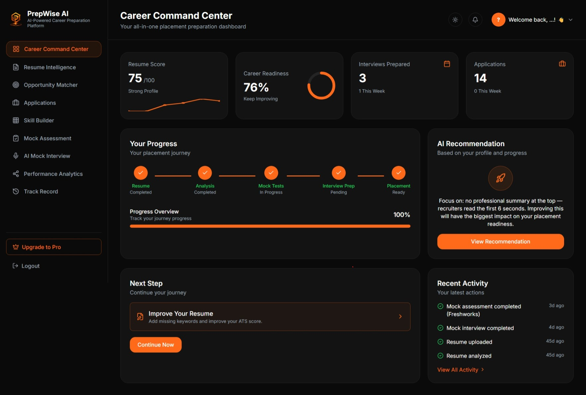
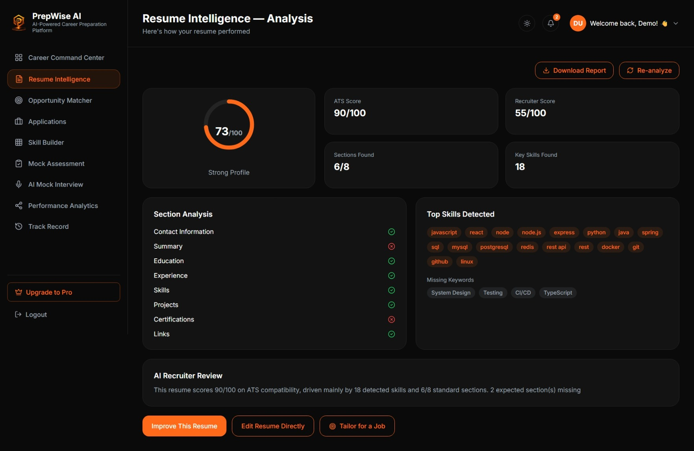
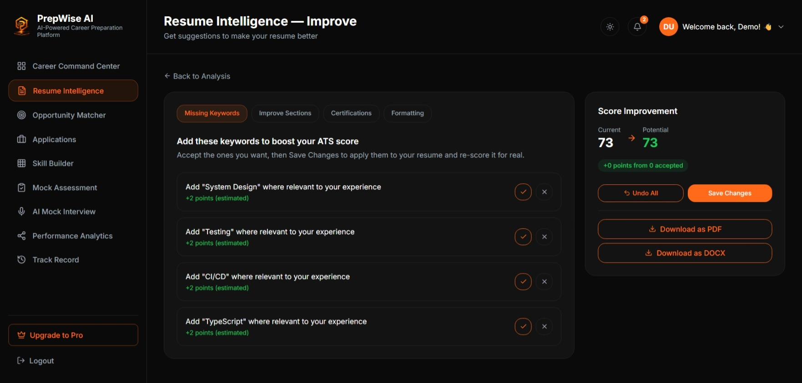
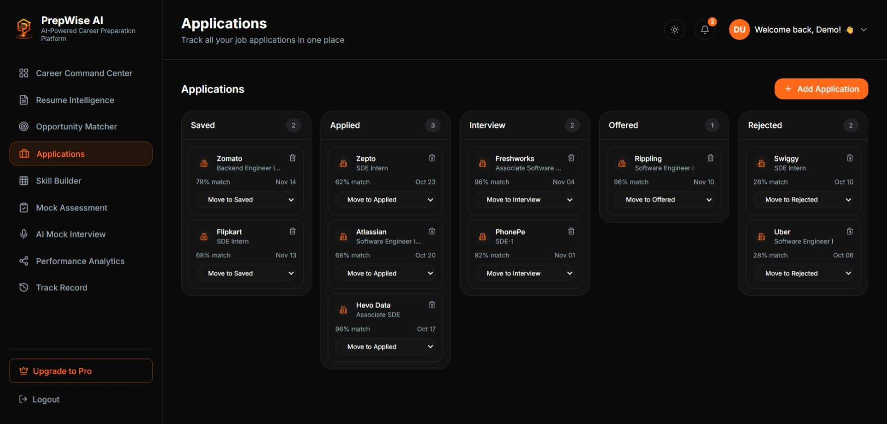
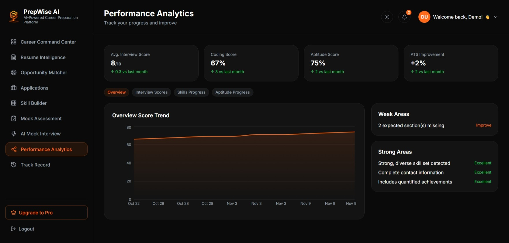
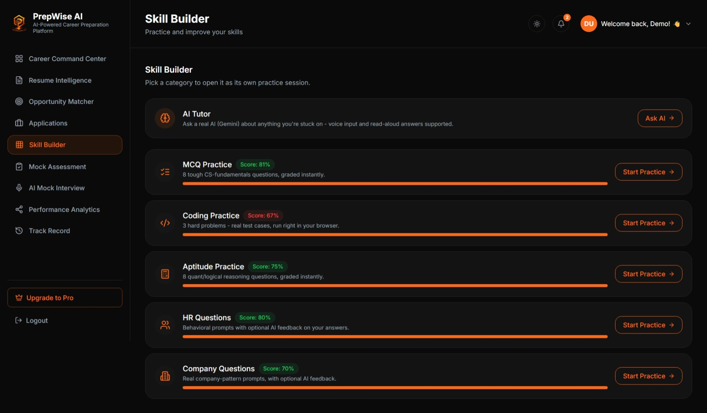

<div align="center">

# 🚀 PrepWise AI

**AI-Powered Career Preparation Platform**

Resume Intelligence → Opportunity Matching → Skill Building → Mock Assessment → AI Mock Interview → Performance Analytics


**Prepare smarter. Practice deliberately. Improve measurably.**

**Live:** [prepwise-ai-1-zm7p.onrender.com](https://prepwise-ai-1-zm7p.onrender.com) · **API:** [prepwise-ai-1j84.onrender.com](https://prepwise-ai-1j84.onrender.com/api/health)

<sub>Hosted on Render's free tier, so the first request after a period of inactivity can take up to a minute while the server wakes up.</sub>

</div>

---

## 🔑 Two ways to try it

| | Link | What you get |
|---|---|---|
| **Demo account** | [Sign in](https://prepwise-ai-1-zm7p.onrender.com/login) with `demo@prepwise.ai` / `demopass123` | A fully populated account: an analysed resume, 14 tracked applications across every pipeline stage, 3 completed mock interviews, 5 company assessments, Skill Builder history and 90 days of performance trends. |
| **Your own account** | [Create an account](https://prepwise-ai-1-zm7p.onrender.com/signup) | A clean account. Upload your own resume and run the real workflow end to end. |

> The demo account is seeded by `backend/scripts/seedDemoUser.js`. Every score it displays is produced by the application's own scoring engine running over the demo resume, not written into the database by hand. Running the script again resets the demo data.

---

## 📸 Screenshots

### Career Command Center
Resume score, career readiness, journey state and the computed next best action.



### Resume Intelligence
ATS, recruiter and quality scores, section analysis, detected skills and missing keywords — all deterministic, with no LLM in the scoring path.



### Improvement suggestions
Each suggestion carries the score impact the engine calculated for it.



### Application Tracker
Every pipeline stage, with match percentages computed against the candidate's resume analysis.



### Performance Analytics
Trends and deltas built from stored metric history rather than a single latest value.



### Skill Builder
Six practice categories with progress and accuracy per category.



---

## 🎯 What is PrepWise AI?

PrepWise AI is a full-stack AI-powered career preparation platform designed for students and early-career developers preparing for technical placements and job applications.

Instead of treating resume analysis, job discovery, coding practice, assessments, interviews, and progress tracking as separate tools, PrepWise AI connects them into one placement workflow.

The platform turns a candidate's real resume data, skills, preparation activity, assessment performance, interview performance, and application activity into a connected career-preparation experience.

- No fabricated dashboard numbers.
- No fake application submissions.
- No random match percentages.

---

## 🔥 Product Workflow

```text
┌──────────────────────┐
│    Resume Upload     │
└──────────┬───────────┘
           ↓
┌──────────────────────────────┐
│     Resume Intelligence      │
│                              │
│ ATS • Skills • Quality       │
│ Sections • Missing Skills    │
│ JD Matching • Suggestions    │
└──────────┬───────────────────┘
           ↓
┌──────────────────────────────┐
│     Opportunity Matcher      │
│                              │
│ Role Fit • Skill Match       │
│ Matched Skills • Missing     │
│ Skills • Job Details         │
└──────────┬───────────────────┘
           ↓
┌──────────────────────────────┐
│      Application Tracker     │
│                              │
│ Saved → Applied → OA →       │
│ Interview → HR → Offered /   │
│ Rejected                     │
└──────────┬───────────────────┘
           ↓
┌──────────────────────────────┐
│        Skill Builder         │
│                              │
│ MCQ • Coding • Aptitude      │
│ AI Tutor • HR • Company      │
└──────────┬───────────────────┘
           ↓
┌──────────────────────────────┐
│       Mock Assessment        │
│                              │
│ Company-Specific Assessment  │
│ Aptitude • Coding • Behavioral│
└──────────┬───────────────────┘
           │
           │ ≥ configured score
           ↓
┌──────────────────────────────┐
│       AI Mock Interview      │
│                              │
│ Resume • Projects • Role     │
│ Company • Technical • HR     │
└──────────┬───────────────────┘
           ↓
┌──────────────────────────────┐
│     Performance Analytics    │
│                              │
│ Trends • Weak Areas •        │
│ Strong Areas • Progress      │
└──────────┬───────────────────┘
           ↓
┌──────────────────────────────┐
│     Career Command Center    │
│                              │
│ What have I completed?       │
│ Where am I now?              │
│ What should I do next?       │
└──────────────────────────────┘
```

---

## ✨ Core Features

### 📄 1. Resume Intelligence

Turn a raw resume into a structured candidate profile.

**Capabilities**

- PDF resume upload (the upload middleware accepts `application/pdf` only)
- Deterministic ATS-style analysis
- Resume quality scoring
- Recruiter-oriented signals
- Section analysis
- Skill detection
- Keyword detection
- Missing skills
- Missing keywords
- Strengths and weaknesses
- Job-description matching
- Resume improvement suggestions with per-item score impact
- Direct resume editing
- Re-scoring after changes
- JD-specific Tailored Resume generation
- PDF/DOC export

**How the scoring actually works**

Nothing in the score comes from an LLM. `services/atsEngine.js` computes it from measurable properties of the resume text:

| Score | Composition |
|---|---|
| **ATS** | section completeness (40) + skill density (35) + contact details present (25) |
| **Recruiter** | action-verb density (40) + quantified achievements (30) + length sanity (30) |
| **Quality** | bullet-point density (40) + length sanity (40) + section completeness (20) |
| **Overall** | ATS × 0.4 + Recruiter × 0.3 + Quality × 0.3 |
| **JD match** | overlap between skills detected in the resume and skills detected in the job description |

**Important engineering decision**

Core scoring is separated from AI-generated commentary. Gemini can assist with explanation, rewriting, suggestions, generation and open-ended feedback, but AI-generated text does not silently overwrite the underlying deterministic score.

### 🎯 2. Opportunity Matcher

Opportunity Matcher connects the candidate's resume intelligence with available job and internship opportunities.

| Candidate signals | Job signals | Results |
|---|---|---|
| Detected skills | Required skills | Match percentage |
| Missing skills | Preferred skills | Matched skills |
| Predicted role | Role/category | Missing skills |
| Resume quality signals | Job metadata | Match explanation |
| Education | | Job details |
| Experience | | Save action |
| Projects | | Apply action |
| Certifications | | |

Match percentage is computed in `services/jobMatcher.js` as skill coverage weighted at 85% plus a resume-quality factor weighted at 15%. Skill gaps discovered here are folded back into the shared Resume Analysis profile so Skill Builder and Resume Improvement see them too.

The current opportunity pipeline supports a database-backed job catalog and Internshala synchronization.

**Application principle**

```text
Candidate Resume
       ↓
Candidate Profile
       ↓
Opportunity Matching
       ↓
External Job Posting
       ↓
Candidate Applies Externally
```

PrepWise AI does not submit applications on behalf of the candidate. The Apply action opens the real external opportunity.

**Known limitation:** scraped listings carry whatever skill tags the poster used, so a backend internship can arrive tagged with unrelated skills such as content writing or digital marketing. The matcher is working correctly on noisy input. Filtering listing tags by role category is the next improvement here.

### 📌 3. Application Tracker

A dedicated application tracker records the candidate's engagement with opportunities across seven pipeline stages.

```text
Saved → Applied → Online Assessment → Interview → HR → Offered / Rejected
```

The tracker maintains application status, job association, dates, notes, match percentage and current pipeline state.

PrepWise AI records the candidate's application activity but does not pretend to submit external applications.

### 🧠 4. Skill Builder

Skill Builder provides focused preparation across multiple categories.

| Category | Purpose |
|---|---|
| 📝 MCQ | Technical knowledge |
| 💻 Coding | Programming problem solving |
| 📐 Aptitude | Quantitative and logical preparation |
| 🤖 AI Tutor | Interactive AI-supported learning |
| 👔 HR | Behavioral preparation |
| 🏢 Company | Company-specific preparation |

**Practice experience**

- One-question-at-a-time flow
- Progress tracking
- Real coding test execution
- Randomized practice subsets
- Result summaries
- AI-supported open-answer feedback
- AI Tutor conversations
- Practice history

Coding submissions are evaluated against actual test cases rather than self-reported results.

### 📝 5. Company-Specific Mock Assessment

Mock Assessments are company-specific. Company selection uses searchable company data, and the assessment pattern changes according to the selected company's configured style.

**Assessment capabilities**

- Company-specific patterns
- Aptitude-focused assessments
- Coding-focused assessments
- Balanced assessments
- Behavioral assessments
- Countdown timer
- Automatic submission at timeout
- Score calculation
- Configurable pass threshold
- Assessment history
- Progression gate

The default configurable assessment threshold is **80%**, configured through:

```env
MOCK_ASSESSMENT_PASS_THRESHOLD=80
```

The webcam functionality is a visual proctoring simulation only. It does not record or upload webcam footage.

### 🎤 6. AI Mock Interview

The AI Mock Interview experience is designed around the candidate instead of using a generic question list.

Questions can incorporate resume content, projects, target company, target role, technical topics and behavioral topics.

Answers are scored on communication, technical depth and confidence, and the session summary aggregates those into an overall score and a list of weak topics that feeds back into preparation recommendations and analytics.

### 📊 7. Performance Analytics

Performance Analytics aggregates historical activity across the platform.

**Analytics areas**

- ATS trends
- Coding progress
- Aptitude progress
- Interview scores
- Skill progress
- Weak areas
- Strong areas
- Application activity
- Assessment history
- Interview history

Every trend is read back from the `metric_snapshots` table, so the platform shows progress over time rather than only the latest score.

---

## 🤖 AI Integration

PrepWise AI integrates the Google Gemini API for generative and reasoning-based features.

**Gemini-powered functionality**

- AI Tutor
- Resume wording assistance
- Resume improvement
- Tailored resume generation
- Open-ended answer feedback
- Interview-oriented feedback

**AI architecture**

```text
Frontend
   │
   │ REST API
   ↓
Express Backend
   │
   │ Server-side AI request
   ↓
Google Gemini API
   │
   ↓
Generated Response
   │
   ↓
Backend
   │
   ↓
Frontend
```

Gemini API credentials remain server-side. The frontend never directly exposes the Gemini API key.

---

## 🧮 Real-Data Philosophy

PrepWise AI deliberately avoids fake dashboard metrics.

**Deterministic systems** — calculated from actual application data:

ATS score · resume quality signals · JD match · job match · matched skills · missing skills · skill progress · assessment results · next best action · analytics trends · analytics deltas

**AI-assisted systems** — Gemini is used where generative reasoning adds value:

AI Tutor · resume improvement · tailored resume generation · open-ended feedback · interview support

This separation keeps scoring and state transitions predictable while still using AI where it helps.

---

## 🏗️ Architecture

```text
┌──────────────────────────────────────────────────────────┐
│                     React + Vite                          │
│                                                          │
│ Dashboard • Resume • Opportunities • Skills • Assessment │
│ Interview • Applications • Analytics                     │
└──────────────────────────┬───────────────────────────────┘
                           │
                           │ REST API / Axios
                           │ JWT
                           ▼
┌──────────────────────────────────────────────────────────┐
│                  Express + Node.js                        │
│                                                          │
│ Auth • Resume • ATS • Jobs • Applications • Skills       │
│ Assessment • Interview • Analytics                       │
└──────────────────────────┬───────────────────────────────┘
                           │
                           │ Sequelize / MySQL
                           ▼
┌──────────────────────────────────────────────────────────┐
│                         MySQL                            │
│                                                          │
│ Users • Resumes • Resume Analyses • Jobs • Applications   │
│ Skills • Assessments • Interviews • Metrics • Companies  │
└──────────────────────────────────────────────────────────┘

                           │
                           │ Server-side AI requests
                           ▼
┌──────────────────────────────────────────────────────────┐
│                    Google Gemini API                     │
│                                                          │
│ Tutor • Resume Assistance • Feedback • Interview Support │
└──────────────────────────────────────────────────────────┘
```

---

## 🛠️ Tech Stack

| Area | Technologies |
|---|---|
| **Frontend** | React, Vite, Tailwind CSS, React Router DOM, Axios, Recharts, Framer Motion, Lucide React |
| **Backend** | Node.js, Express.js, Sequelize, MySQL, MySQL2, JWT, bcrypt / bcryptjs, Multer, REST APIs, CORS |
| **AI** | Google Gemini API, @google/genai |
| **Testing** | Jest, Supertest |
| **Deployment** | Render (frontend static site), Render (backend web service), MySQL (database) |

---

## 🗄️ Database

PrepWise AI uses MySQL as its primary database. There is no MongoDB dependency in the current architecture.

**Tables (12)**

`users` · `resumes` · `resume_analyses` · `jobs` · `applications` · `skill_progress` · `skill_attempts` · `assessment_attempts` · `interview_sessions` · `interview_questions` · `companies` · `metric_snapshots`

Authentication stores passwords as bcrypt hashes, never plaintext passwords.

The database schema is maintained under `backend/database/schema.sql`.

---

## 🔐 Authentication & Security

PrepWise AI uses JWT-based authentication.

**Security features**

- JWT authentication
- Protected API routes
- Protected frontend routes
- bcrypt password hashing
- Environment-based secrets
- CORS protection
- Server-side Gemini API calls
- `.env` excluded from Git
- API keys excluded from Git
- Generated uploads excluded
- `node_modules` excluded

**Authentication flow**

```text
User
 ↓
Sign Up / Login
 ↓
Backend validates credentials
 ↓
Password verified / hashed
 ↓
JWT issued
 ↓
Frontend stores token
 ↓
Protected requests include:
Authorization: Bearer <token>
```

---

## 🔑 Environment Variables

Create `backend/.env`:

```env
NODE_ENV=development

PORT=5000

DB_HOST=localhost
DB_PORT=3306
DB_NAME=prepwise_ai_app
DB_USER=root
DB_PASSWORD=your_password

JWT_SECRET=your_long_random_secret

GEMINI_API_KEY=your_gemini_api_key
GEMINI_MODEL=gemini-2.5-flash

CLIENT_ORIGIN=http://localhost:5173

MOCK_ASSESSMENT_PASS_THRESHOLD=80

# Optional — used by scripts/seedDemoUser.js
DEMO_EMAIL=demo@prepwise.ai
DEMO_PASSWORD=demopass123
```

**Frontend environment:** create `frontend/.env`:

```env
VITE_API_URL=http://localhost:5000
```

**Production frontend** uses:

```env
VITE_API_URL=https://prepwise-ai-1j84.onrender.com
```

The application appends `/api` to the backend base URL where required. Vite reads this value at build time, so redeploy the frontend after changing it.

> Never commit `.env` files or API keys to GitHub.

---

## 📁 Project Structure

```text
prepwise-ai/
│
├── frontend/
│   ├── src/
│   │   ├── api/
│   │   ├── assets/
│   │   ├── components/
│   │   ├── context/
│   │   ├── hooks/
│   │   ├── layouts/
│   │   ├── pages/
│   │   └── utils/
│   │
│   ├── public/
│   ├── package.json
│   ├── vite.config.js
│   └── tailwind.config.js
│
├── backend/
│   ├── config/
│   ├── controllers/
│   ├── data/
│   ├── database/
│   ├── middleware/
│   ├── models/
│   ├── routes/
│   ├── scripts/
│   ├── services/
│   ├── tests/
│   └── server.js
│
├── docs/
├── .gitignore
└── README.md
```

---

## 🚀 Getting Started

**1. Clone the repository**

```bash
git clone https://github.com/Jnana1964/prepwise-ai.git
cd prepwise-ai
```

**2. Configure MySQL:** create the database and apply `backend/database/schema.sql`:

```bash
mysql -u root -p < backend/database/schema.sql
```

**3. Configure backend**

```bash
cd backend
npm install
```

Create `backend/.env` and add your MySQL configuration, JWT secret, Gemini API key, Gemini model and CORS origin.

**4. Seed reference and demo data (optional)**

```bash
node scripts/seedCompanies.js
node scripts/seedDemoUser.js
```

`seedCompanies.js` loads the company catalog used by Mock Assessment and AI Mock Interview. `seedDemoUser.js` creates the demo account described at the top of this README. It is safe to run repeatedly and only ever touches the demo user's own rows.

**5. Start backend**

```bash
npm run dev
```

**6. Start frontend:** open another terminal:

```bash
cd frontend
npm install
npm run dev
```

---

## 🧪 Validation

The project includes automated validation for:

- ATS determinism
- Job-match boundaries
- Authentication validation
- Assessment threshold behavior
- Interview gating
- Company isolation
- Application authorization
- API behavior

**Backend tests**

```bash
cd backend
npm test
```

**Frontend production build**

```bash
cd frontend
npm run build
```

---

## 🌐 Production Deployment

PrepWise AI is deployed as a full-stack application on Render.

| Layer | Platform | URL |
|---|---|---|
| Frontend | Render (static site) | <https://prepwise-ai-1-zm7p.onrender.com> |
| Backend | Render (web service) | <https://prepwise-ai-1j84.onrender.com> |

```text
                   ┌──────────────────────┐
                   │       Render         │
                   │      Frontend        │
                   │   React + Vite       │
                   └──────────┬───────────┘
                              │
                              │ HTTPS REST API
                              ▼
                   ┌──────────────────────┐
                   │       Render         │
                   │       Backend        │
                   │ Node + Express       │
                   └───────┬───────┬──────┘
                           │       │
                           │       │
                           ▼       ▼
                      ┌───────┐ ┌─────────────┐
                      │ MySQL │ │ Gemini API  │
                      └───────┘ └─────────────┘
```

---

## 🔗 Production Links

- **Live Application:** <https://prepwise-ai-1-zm7p.onrender.com>
- **Demo login:** `demo@prepwise.ai` / `demopass123`
- **Create your own account:** <https://prepwise-ai-1-zm7p.onrender.com/signup>
- **Backend API health:** <https://prepwise-ai-1j84.onrender.com/api/health>
- **Source Code:** <https://github.com/Jnana1964/prepwise-ai>

---

## 🌐 Opportunity Integration

PrepWise AI supports database-backed opportunities and Internshala synchronization.

```text
External Opportunity Source
          ↓
Synchronization
          ↓
Normalized Job Data
          ↓
MySQL jobs table
          ↓
Candidate Matching
          ↓
Match Explanation
          ↓
External Apply Link
```

The Internshala integration retrieves current public internship listings, stores normalized opportunities, supports periodic synchronization, updates existing opportunities, fails softly when the external source changes, and does not submit applications automatically.

The candidate completes the actual application on the external platform.

---

## 📄 Resume Tailoring

Tailored Resume allows a candidate to provide a job description and generate a role-focused version of the resume. The generation is constrained to the candidate's existing information.

| It does not invent | It can |
|---|---|
| Employers | Reword existing experience |
| Job titles | Reorganize relevant information |
| Dates | Emphasize matching skills |
| Achievements | Target the supplied job description |
| Experience | |

The objective is to improve relevance without fabricating candidate information.

---

## 🧠 Progression Gates

PrepWise AI uses real completion and score state to control progression.

```text
Resume
   ↓
Skill Builder
   ↓
Mock Assessment
   ↓
Assessment Score
   ↓
AI Mock Interview
   ↓
Performance Analytics
```

Default assessment threshold: **80%**, configurable through `MOCK_ASSESSMENT_PASS_THRESHOLD`.

Assessment and interview access depend on persisted completion and score state rather than arbitrary frontend conditions.

---

## 💡 Engineering Highlights

| # | Highlight | Detail |
|---|---|---|
| 01 | One connected candidate profile | Resume Intelligence creates persisted candidate information consumed by every downstream module. |
| 02 | Deterministic scoring | ATS, recruiter and quality scores are computed from measurable properties of the resume text, with documented weightings. |
| 03 | Deterministic matching | Opportunity matching uses structured candidate and job data instead of random percentages. |
| 04 | Real progression gates | Assessment and interview access depend on persisted completion and score state. |
| 05 | Real persistence | User progress is stored in MySQL rather than relying only on browser state. |
| 06 | AI plus deterministic systems | AI handles generation and reasoning where useful while core scoring and state logic remain predictable. |
| 07 | External application integrity | PrepWise never claims to submit applications on behalf of the candidate. |
| 08 | Historical analytics | Performance is represented as trends and deltas rather than only the latest result. |
| 09 | Reproducible demo data | The demo account is generated by a script that runs the application's own scoring engine, so demo values match what the product would really produce. |

---

## 🛡️ Production Principles

| Principle | What it means |
|---|---|
| **No fake metrics** | Dashboard values are computed from actual application data. |
| **No fabricated opportunities** | Job data comes from the application's job catalog and synchronized sources. |
| **No fake application submission** | PrepWise opens the external opportunity. The candidate submits the application. |
| **No fabricated resume facts** | Resume tailoring is constrained to the candidate's existing information. |
| **No hand-written demo numbers** | The demo account is seeded by running the real scoring engine, not by typing scores into the database. |
| **No exposed AI credentials** | Gemini API keys remain server-side. |
| **No plaintext passwords** | Passwords are hashed using bcrypt. |

---

## 🗺️ Known Limitations & Next Steps

Stated openly, because a portfolio project that claims to be finished is not credible.

| Area | Current state | Next step |
|---|---|---|
| Coding question bank | 3 problems | Expand to 25+ across difficulty levels |
| Scraped job tags | Listings carry unrelated skill tags from the source | Filter listing tags by role category before matching |
| Skill detection | Substring matching can produce occasional false positives | Word-boundary matching (in progress) |
| Resume upload | PDF only | Add DOCX parsing |
| Demo data | Reset manually by re-running the seeder | Scheduled nightly reset |
| Improve Resume page | Reachable by route but not linked in the sidebar | Add navigation entry |

---

## 📦 Important Commands

| Task | Command |
|---|---|
| Install backend dependencies | `cd backend && npm install` |
| Start backend | `npm run dev` |
| Seed company catalog | `node scripts/seedCompanies.js` |
| Seed / reset demo account | `node scripts/seedDemoUser.js` |
| Install frontend dependencies | `cd frontend && npm install` |
| Start frontend | `npm run dev` |
| Build frontend | `npm run build` |
| Run backend tests | `npm test` |

---

## 🔒 Security Rules

Never commit `.env`, `.env.local`, `.env.production`, API keys, JWT secrets, database passwords, generated uploads or `node_modules`.

Especially never commit `GEMINI_API_KEY`.

Production secrets should be configured through the deployment platform's environment-variable settings.

---

## 👤 Author

<div align="center">

**Bollu Jnana Keerthana**

B.Tech Computer Science and Engineering · SRM Institute of Science and Technology

[GitHub](https://github.com/Jnana1964) · [Portfolio](https://jnana1964.github.io)

</div>

---

## 📜 License

This project is developed as a portfolio / academic project.
